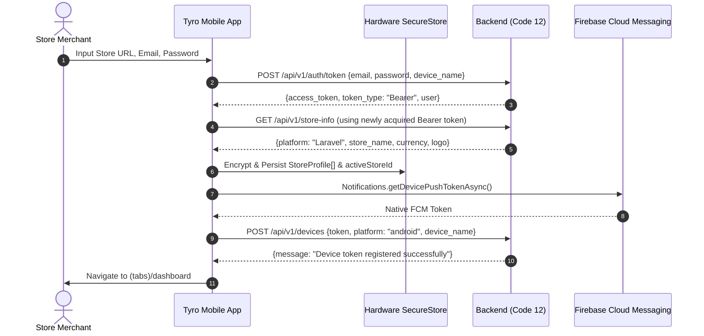

# STATE.md — MULTI-STORE STATE MACHINE & CREDENTIAL LIFECYCLE

> **VAULT LOCK STATUS:** ACTIVE (`CLAUDE.md` -> `STATE.md`)

---

## 1. MULTI-STORE CONNECTION & TOKEN LIFECYCLE



---

## 2. STATE PERSISTENCE SPECIFICATIONS (`src/store/authStore.ts`)

1. **Storage Mechanism:**
   - Backed by `expo-secure-store` using encrypted hardware-backed storage keys:
     - `tyro_stores`: JSON serialized array of connected `StoreProfile` objects.
     - `tyro_active_store_id`: String ID of the currently selected store.
2. **`StoreProfile` Interface:**
   ```ts
   export interface StoreProfile {
     id: string;              // Unique client hash / UUID
     store_url: string;       // Normalized HTTPS store root (e.g., https://aamzo.com)
     store_name: string;      // Display name from /api/v1/store-info
     currency: string;        // Currency symbol (e.g., ৳ or $)
     access_token: string;    // Sanctum PlainText Bearer Token
     user: {
       id: number;
       name: string;
       email: string;
       role: string;
     };
     connected_at: string;
   }
   ```
3. **Hydration Lifecycle (`initialize()`):**
   - On cold start, `initialize()` reads `tyro_stores` and `tyro_active_store_id` from `SecureStore`.
   - Sets `isInitialized: true`.
   - Never render routing redirects before `isInitialized === true`.

---

## 3. DYNAMIC MULTI-TENANT NETWORK INTERCEPTORS (`src/api/client.ts`)

1. **Dynamic BaseURL & Header Injection (Request Interceptor):**
   - Intercepts all outgoing Axios requests.
   - Reads active store: `const store = useAuthStore.getState().getActiveStore()`.
   - If a relative URL (`/api/v1/...`) is supplied:
     - `config.baseURL = store.store_url`.
     - `config.headers['Authorization'] = `Bearer ${store.access_token}``.
     - `config.headers['Accept'] = 'application/json'`.
2. **Automatic 401 Session Revocation (Response Interceptor):**
   - If an API returns `401 Unauthorized`:
     - Calls `useAuthStore.getState().handleUnauthorized(activeStoreId)`.
     - Removes or invalidates the token for that specific store profile.
     - Switches to another connected store if available, or redirects to `/login`.

